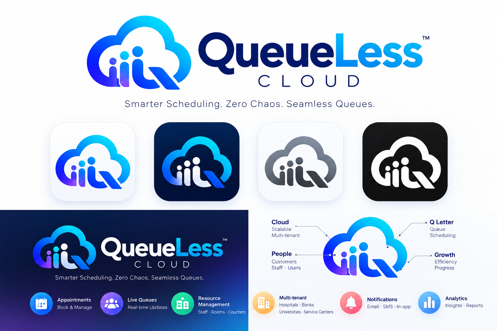
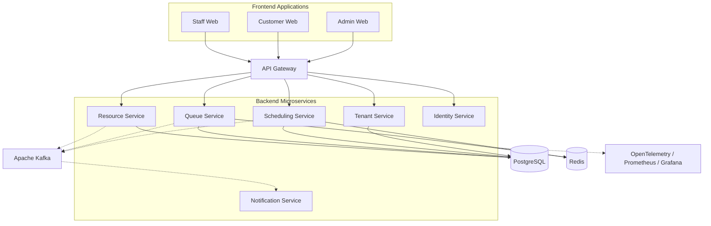

# ☁️ QueueLess Cloud

<div align="center">



### Distributed Scheduling & Resource Orchestration Platform

**Smarter Scheduling. Zero Chaos. Seamless Queues.**

[](https://www.apache.org/licenses/LICENSE-2.0)


**An open-source engineering initiative by [FirstXperiment](https://github.com/FirstXperiment).**

</div>

---

## 📖 Overview

**QueueLess Cloud** is an open-source, cloud-native, multi-tenant SaaS platform designed to modernize appointment scheduling, queue management, and resource allocation across service-driven organizations.

The platform aims to help organizations coordinate customers, staff, facilities, and services through a unified scheduling and queue orchestration system.

QueueLess Cloud is being designed as a distributed system with independently deployable applications and services, event-driven communication, secure tenant isolation, and production-oriented engineering practices.

**Current status:** Early development. The architecture, technology stack, and roadmap described here represent the intended direction of the project. Features should not be considered available until implemented and documented.

### ✅ Repository Checklist

This checklist reflects the current state of the repository. A checked item means the repository foundation is present; it does not imply that the related product feature is complete.

- [x] Project README and initial product direction
- [x] Apache 2.0 license
- [x] Initial project branding and logo
- [ ] Monorepo application and service directories
- [ ] Local Docker Compose development environment
- [ ] React frontend application
- [ ] Backend services and API contracts
- [ ] Database schema and migrations
- [ ] Automated tests and quality checks
- [ ] CI/CD workflows
- [ ] Deployment and operational documentation

See the [development planning documentation](docs/development/README.md) for the implementation sequence.

## 🌍 The Problem

Traditional appointment and queue management systems often suffer from:

- Long and unpredictable waiting times.
- Inefficient allocation of staff, rooms, and service counters.
- Double bookings and scheduling conflicts.
- Limited visibility into real-time queue positions.
- Difficulty managing multiple branches and organizations.
- Poor scalability during peak demand.
- Fragmented notification and reporting systems.

QueueLess Cloud aims to address these challenges through a unified, extensible scheduling and resource orchestration platform.

## 🎯 Mission

To build flexible, reliable, and scalable scheduling infrastructure that helps organizations reduce waiting times, improve resource utilization, and deliver better service experiences.

## ✨ Planned Core Features

### 🏢 Multi-Tenant SaaS Architecture

- Organization registration and onboarding.
- Multiple branches under each organization.
- Tenant-isolated data and configuration.
- Role-based access control (RBAC).
- Organization-specific scheduling policies.
- Tenant-aware API authorization.

### 📅 Intelligent Appointment Scheduling

- Appointment creation, cancellation, and rescheduling.
- Configurable appointment durations.
- Staff and resource availability management.
- Prevention of conflicting reservations.
- Timezone-aware scheduling.
- Recurring availability rules.
- Idempotent booking operations.
- Waitlist management.

### 🎟️ Real-Time Queue Management

- Digital queue token generation.
- Live queue status tracking.
- Queue prioritization and service categories.
- Estimated waiting times.
- Walk-in and appointment-based queues.
- Real-time customer notifications.
- Queue reassignment and escalation.

### ⚙️ Resource Orchestration

- Staff scheduling and availability.
- Room and service-counter allocation.
- Resource capacity management.
- Resource conflict detection.
- Workload balancing.
- Dynamic resource assignment.

### 🔔 Notification System

- Appointment confirmation messages.
- Queue status notifications.
- Appointment reminders.
- Cancellation and rescheduling alerts.
- Email, SMS, and in-app notification channels.
- Asynchronous notification processing.

### 📊 Analytics and Reporting

- Appointment utilization metrics.
- Average customer waiting times.
- Queue throughput.
- Resource utilization.
- Branch performance.
- Operational dashboards.
- Historical reporting.

## 🏭 Target Industries

QueueLess Cloud is designed around a domain-neutral scheduling and queue orchestration engine.

| Industry | Example Use Cases |
|---|---|
| Healthcare | Doctor appointments, consultation queues, diagnostic resources |
| Banking | Customer service appointments, counter allocation |
| Education | Student services, counseling appointments, administrative queues |
| Government | Citizen service centers, document processing appointments |
| Enterprise | Internal service desks, meeting and resource scheduling |
| Service Centers | Walk-in management, technician appointments |

Industry-specific functionality may be introduced through configurable workflows and extensible service modules.

---

## 🏗️ System Architecture

QueueLess Cloud follows a planned **microservices-oriented, event-driven architecture** organized within a monorepo.



*Conceptual architecture only. The diagram simplifies storage and service communication. Each service will own its data boundary; shared access to another service's database is not intended.*

### Architectural Principles

1. **Domain-driven service boundaries:** Services represent distinct business capabilities.
2. **Independent deployment:** Each service can be built, tested, versioned, and deployed independently.
3. **Database ownership:** Services own their data and expose APIs or events for interaction.
4. **Event-driven communication:** Asynchronous workflows use domain events where appropriate.
5. **Consistency by design:** Critical operations such as slot reservation require transactional guarantees.
6. **Fault isolation:** Failures in noncritical services should not interrupt core booking operations.
7. **Tenant isolation:** Tenant context must be enforced throughout authentication, authorization, and data access.
8. **Observability:** Logs, metrics, and traces should provide visibility into distributed operations.
9. **Incremental complexity:** Infrastructure and services are introduced when justified by requirements.

## 🧩 Planned Backend Services

| Service | Primary Responsibility | Proposed Technology |
|---|---|---|
| API Gateway | Request routing, rate limiting, entry-point security | To be finalized |
| Identity Service | Authentication, authorization, user identity | NestJS / Keycloak integration |
| Tenant Service | Organizations, branches, tenant configuration | NestJS |
| Scheduling Service | Availability, appointments, booking consistency | Go |
| Queue Service | Queue tokens, queue progression, real-time updates | Go |
| Resource Service | Staff, rooms, counters, capacity allocation | Go |
| Notification Service | Reminders, alerts, asynchronous message delivery | NestJS |

Service boundaries and implementation languages may evolve through architecture decision records.

---

## 📁 Repository Structure

QueueLess Cloud uses an **application-and-service-oriented monorepo**.

Frontend applications, backend microservices, shared contracts, infrastructure, and documentation are maintained in a single repository while retaining independent build and deployment boundaries.

```text
QueueLess-Cloud/
│
├── apps/                              # Frontend applications
│   ├── admin-web/
│   ├── customer-web/
│   └── staff-web/
│
├── services/                          # Backend microservices
│   ├── api-gateway/
│   ├── identity-service/
│   ├── tenant-service/
│   ├── scheduling-service/
│   ├── queue-service/
│   ├── resource-service/
│   └── notification-service/
│
├── packages/                          # Shared contracts and tooling
│   ├── api-contracts/
│   ├── protobuf/
│   └── shared-config/
│
├── infrastructure/                    # Infrastructure and deployment
│   ├── docker/
│   ├── kubernetes/
│   ├── terraform/
│   └── monitoring/
│
├── docs/                              # Engineering documentation
│   ├── architecture/
│   ├── adr/
│   ├── api/
│   └── development/
│
├── tests/                             # Cross-service tests
│   ├── e2e/
│   ├── contract/
│   └── performance/
│
├── .github/
│   ├── workflows/
│   ├── ISSUE_TEMPLATE/
│   └── PULL_REQUEST_TEMPLATE.md
│
├── QueueLessCloud.png
├── compose.yaml
├── .env.example
├── Makefile
├── CONTRIBUTING.md
├── CODE_OF_CONDUCT.md
├── SECURITY.md
├── LICENSE
└── README.md
```

*This is the target structure. Directories and files will be created incrementally as development progresses.*

### Frontend Applications

All frontend applications are maintained inside `apps/`.

| Application | Purpose |
|---|---|
| `admin-web` | Organization administration, branch configuration, analytics |
| `customer-web` | Appointment booking, queue status, customer experience |
| `staff-web` | Queue operations, resource assignments, service management |

Each application will have its own dependencies, configuration, tests, build process, and deployment artifact.

### Backend Microservices

All backend services are maintained inside `services/`.

Each microservice should be self-contained and independently testable.

Example:

```text
services/
└── scheduling-service/
    ├── cmd/
    ├── internal/
    ├── migrations/
    ├── tests/
    ├── Dockerfile
    ├── go.mod
    └── README.md
```

For NestJS services, the internal layout will follow appropriate NestJS and TypeScript conventions instead of forcing Go-specific directories.

### Shared Packages

The `packages/` directory contains reusable contracts and development tooling.

Shared packages should not become a place for tightly coupling service business logic.

Examples include:

- OpenAPI contracts.
- Protobuf definitions.
- Shared schema definitions.
- Linting and formatting configurations.
- Code generation tooling.

---

## 📐 Engineering Naming Conventions

Consistency is important for maintainability and collaboration.

| Item | Convention | Example |
|---|---|---|
| Directories | `kebab-case` | `tenant-service/` |
| Microservices | `kebab-case` with `-service` suffix | `scheduling-service/` |
| Frontend applications | `kebab-case` with `-web` suffix | `admin-web/` |
| Shared packages | `kebab-case` | `api-contracts/` |
| React components | `PascalCase` | `TenantDashboard.tsx` |
| TypeScript utilities | `kebab-case` | `date-utils.ts` |
| Go source files | `snake_case` | `booking_handler.go` |
| Environment variables | `UPPER_SNAKE_CASE` | `DATABASE_URL` |
| Documentation files | `kebab-case` | `system-architecture.md` |
| Git branches | `type/short-description` | `feat/appointment-booking` |

### Naming Rules

- Use lowercase directory names.
- Separate words using hyphens.
- Avoid spaces and unnecessary abbreviations.
- Name services after business capabilities.
- Keep Docker image and deployment identifiers consistent with service names.
- Follow language-specific conventions inside each application.
- Use descriptive names rather than generic identifiers.

Detailed conventions will be maintained in `docs/development/coding-standards.md`.

---

## 🛠️ Technology Stack

The following technologies are planned for the platform. Adoption will be incremental.

| Category | Technologies |
|---|---|
| Frontend | React, TypeScript, Vite, Tailwind CSS |
| Backend | Go, NestJS |
| API Communication | REST, OpenAPI, gRPC |
| Primary Database | PostgreSQL |
| Caching | Redis |
| Event Streaming | Apache Kafka |
| Authentication | Keycloak, OAuth 2.0, OpenID Connect |
| Containerization | Docker, Docker Compose |
| Orchestration | Kubernetes |
| Infrastructure as Code | Terraform |
| CI/CD | GitHub Actions |
| Metrics | Prometheus |
| Dashboards | Grafana |
| Distributed Tracing | OpenTelemetry |
| Frontend Testing | Vitest, Playwright |
| Performance Testing | k6 |

The first development milestone focuses on React, NestJS, PostgreSQL, and Docker. Other technologies will be introduced as needed.

## 🔄 Distributed Systems Engineering

QueueLess Cloud is intended to demonstrate distributed systems concepts through practical implementation.

### Concurrency and Consistency

- Database transactions.
- Unique constraints and conflict detection.
- Optimistic and pessimistic concurrency control.
- Idempotency keys.
- Retry-safe operations.
- Prevention of double booking.

### Event-Driven Workflows

- Domain events.
- Transactional outbox pattern.
- Idempotent event consumers.
- Retry policies and exponential backoff.
- Dead-letter queues.
- Event schema versioning.
- Eventual consistency.
- Compensating workflows where required.

### Reliability and Scalability

- Horizontal scaling.
- Service health checks.
- Graceful shutdown.
- Timeouts and circuit breakers.
- Backpressure and load shedding.
- Structured logging.
- Distributed tracing.
- Load and stress testing.

## 🔐 Security and Tenant Isolation

Security is a fundamental architectural requirement.

Planned controls include:

- OAuth 2.0 and OpenID Connect authentication.
- Role-based and tenant-scoped authorization.
- Tenant isolation at application and database access layers.
- Secure handling of credentials and secrets.
- API rate limiting and request validation.
- Audit logging for sensitive operations.
- Dependency and container vulnerability scanning.
- Secure service-to-service communication.
- Principle of least privilege.
- Automated authorization and tenant isolation tests.

---

## 🚀 Getting Started

**Project status:** Engineering foundation in progress.

The repository can be cloned using:

```bash
git clone https://github.com/FirstXperiment/QueueLess-Cloud.git

cd QueueLess-Cloud
```

Local application startup commands will be documented once the initial frontend, backend, and Docker Compose configuration have been implemented.

The planned local development environment will include:

- React admin application.
- NestJS tenant service.
- PostgreSQL database.
- Docker Compose infrastructure.
- API health checks.
- Automated tests.

Service-specific setup instructions will be maintained in `docs/development/`.

## 🧪 Testing Strategy

| Test Type | Purpose |
|---|---|
| Unit Tests | Validate isolated business logic |
| Integration Tests | Verify database and infrastructure interactions |
| Contract Tests | Validate service communication |
| End-to-End Tests | Verify complete user workflows |
| Concurrency Tests | Detect race conditions and booking conflicts |
| Performance Tests | Measure throughput, latency, and resource usage |
| Security Tests | Validate authorization and tenant isolation |

CI workflows will progressively enforce formatting, linting, tests, and build validation.

## 🚢 CI/CD and Deployment Strategy

Each deployable application or service should have its own build and release lifecycle.

The planned delivery pipeline includes:

1. Pull request validation.
2. Code formatting and linting.
3. Automated unit and integration tests.
4. Container image build.
5. Dependency and image vulnerability scanning.
6. Image publishing to a container registry.
7. Deployment to the appropriate environment.
8. Health verification and observability checks.

GitHub Actions workflows will use path-based filtering where appropriate to avoid unnecessary builds.

### Environment Strategy

| Environment | Purpose |
|---|---|
| Local | Developer machines and Docker Compose |
| Development | Shared integration and ongoing development |
| SIT | System integration testing |
| UAT | Business and acceptance testing |
| Staging / Preproduction | Production-like deployment validation |
| Production | Live customer workloads |

Environment configurations and secrets must remain isolated.

Not every environment needs to be provisioned during the initial development phase.

---

## 🗺️ Development Roadmap

The detailed, living implementation plan is maintained in [`docs/development/README.md`](docs/development/README.md). The checklist below provides a short overview of the planned phases.

### Phase 1 — Engineering Foundation

- [ ] Define product requirements and domain terminology.
- [ ] Create architecture decision records.
- [ ] Establish the monorepo structure.
- [ ] Initialize the React admin application.
- [ ] Initialize the NestJS tenant service.
- [ ] Configure PostgreSQL and Docker Compose.
- [ ] Add API health checks.
- [ ] Configure initial GitHub Actions workflows.
- [ ] Establish coding and contribution standards.

### Phase 2 — Identity and Multi-Tenancy

- [ ] Implement authentication.
- [ ] Design organization and branch models.
- [ ] Implement tenant onboarding.
- [ ] Implement role-based authorization.
- [ ] Validate tenant data isolation.
- [ ] Add authentication and authorization tests.

### Phase 3 — Scheduling Engine

- [ ] Design appointment and availability models.
- [ ] Implement booking APIs.
- [ ] Implement cancellation and rescheduling.
- [ ] Add concurrency-safe slot reservation.
- [ ] Implement idempotency protection.
- [ ] Add scheduling integration tests.

### Phase 4 — Queue and Resource Orchestration

- [ ] Implement queue token generation.
- [ ] Implement queue state transitions.
- [ ] Add resource availability management.
- [ ] Implement staff and counter allocation.
- [ ] Add real-time queue updates.
- [ ] Introduce waiting-time estimation.

### Phase 5 — Event-Driven Integration

- [ ] Introduce Kafka event publishing.
- [ ] Implement transactional outbox.
- [ ] Implement event consumers.
- [ ] Add retry and dead-letter handling.
- [ ] Integrate notification workflows.
- [ ] Implement distributed tracing.

### Phase 6 — Production Engineering

- [ ] Configure Kubernetes deployments.
- [ ] Add infrastructure automation.
- [ ] Establish deployment environments.
- [ ] Implement observability dashboards.
- [ ] Perform load and resilience testing.
- [ ] Conduct security reviews.
- [ ] Publish deployment and operational documentation.

---

## 🤝 Contributing

**Contributors are welcome!**

QueueLess Cloud is an open-source engineering initiative developed under FirstXperiment.

We welcome contributions involving backend development, frontend development, distributed systems, testing, DevOps, security, documentation, and developer experience.

### Contribution Workflow

1. Review open issues and project documentation.
2. Discuss significant architectural changes before implementation.
3. Fork the repository or create a feature branch if you have write access.
4. Implement changes with appropriate tests.
5. Follow established coding and commit conventions.
6. Submit a pull request describing your changes.
7. Address review feedback before merging.

Detailed guidelines will be maintained in `CONTRIBUTING.md`.

### Branch Naming Convention

```text
feat/appointment-booking
fix/queue-state-transition
refactor/tenant-middleware
docs/architecture-overview
test/concurrent-booking
chore/ci-setup
```

### Commit Convention

We plan to follow Conventional Commits.

```text
feat(scheduling): add appointment reservation endpoint
fix(queue): prevent duplicate token generation
docs(architecture): document service boundaries
test(scheduling): add concurrent booking tests
chore(ci): configure automated checks
```

### Pull Request Expectations

Pull requests should include:

- A clear description of the change.
- Related issue references, where applicable.
- Tests for new or modified behavior.
- Documentation updates when necessary.
- Screenshots for relevant UI changes.
- Notes about breaking changes or migrations.

---

## 📚 Documentation

Engineering documentation will cover:

- Product requirements and domain terminology.
- System architecture and service boundaries.
- Architecture decision records.
- API contracts.
- Database design and migrations.
- Local development.
- CI/CD and deployment procedures.
- Security guidelines.
- Operational runbooks.

Documentation should evolve alongside the implementation.

## 🛡️ Security Reporting

Security vulnerabilities should be reported privately rather than disclosed through public GitHub issues.

A dedicated `SECURITY.md` policy will provide reporting instructions and supported-version information.

## 📜 License

QueueLess Cloud is intended to be distributed under the **Apache License 2.0**.

See the [`LICENSE`](./LICENSE) file for the complete terms.

## 🌟 Project Philosophy

> Build for correctness first, design for scale, automate for reliability, and keep the developer experience simple.

QueueLess Cloud is more than a scheduling application. It is an engineering initiative focused on solving practical coordination challenges while exploring the technologies and architectural patterns used in modern distributed systems.

---

## 🏢 About FirstXperiment

[FirstXperiment](https://github.com/FirstXperiment) is a collaborative software engineering organization focused on experimentation, innovation, and building real-world applications.

We believe in learning by building, sharing knowledge, and creating meaningful open-source software.

**Experiment. Innovate. Build.**

### 🔗 Project Links

- **Organization:** https://github.com/FirstXperiment
- **Repository:** https://github.com/FirstXperiment/QueueLess-Cloud
- **Issues:** https://github.com/FirstXperiment/QueueLess-Cloud/issues
- **Pull Requests:** https://github.com/FirstXperiment/QueueLess-Cloud/pulls

---

<div align="center">

**Built with purpose by FirstXperiment.**

*Smarter Scheduling. Zero Chaos. Seamless Queues.*

</div>
